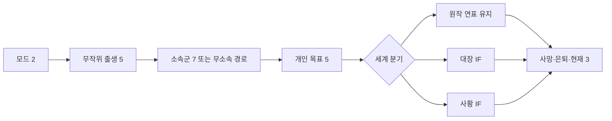

# 이벤트 수·분기·반복 검수 기준

상태: 2026-11-04 전체 게임 제작 목표. **현재 시범판에 구현된 사건 카드는 133개**다. 인간 49개와 다른 네 종족 각 21개이며, 같은 종족 안의 반복 방지 목표는 아직 통과하지 못했다. [구현 현황](BUILD_STATUS.md)을 참고한다. [검토용 예시 원고 3장면](SCENE_EXAMPLE.md)은 별도 기획 자료다. 아래 339장 수량은 전체 원고의 임시 목표이며, 현재 내장·검수 완료 수로 표시하지 않는다.

## 이전 목표를 그대로 쓰지 않는 이유

기존 기획의 158개 장면 조각에는 공통 생활 장면이 25개였다. 한 회차 약 50장면에 공통 25개를 그대로 넣으면 절반이 반복된다. 10회 안에 비슷한 사건이 자주 보이지 않게 하려는 목표에는 부족하다. 공통 장면을 많이 재생하는 구조를 바꾸고, 출신·소속·목표·인연별 선택 가능한 사건 풀을 넓힌다.

## 첫 완성판의 원고 목표: 339개 장면 카드

장면 카드는 고유 사건 ID, 진입 조건, 한 번의 상황·선택 또는 관찰, 결과·후속 연결을 가진 단위다. 이름·대명사·색만 바꾼 문장은 새 카드로 세지 않는다. 같은 세계 사건도 목격·전해 들음·생활에 닥친 여파가 **서로 다른 상황과 결과**일 때만 별도 카드로 센다.

| 풀 | 준비할 카드 | 보통 한 생애에서 사용 | 역할 |
| --- | ---: | ---: | --- |
| 고정 전환점 | 8 | 8 | 출생, 첫 문제, 첫 선택, 생업, 목표, 마지막 시험, 결말 연결 등 구조의 뼈대 |
| 공통 생활 | 80 | 10 | 노동·여행·건강·교류의 다양한 사건. 같은 회차의 중복을 막는다. |
| 출생 묶음 | 5종족 × 12 = 60 | 5 | 고향·종족별 유년과 후속 사건 |
| 소속군 | 7소속 × 10 = 70 | 5 | 가입·책임·승진·이탈의 갈림길 |
| 개인 목표 | 5목표 × 6 = 30 | 4 | 목표를 정하고 시험·수정·이어가는 사건 |
| 인연 연쇄 | 3유형 × 12 = 36 | 5 | 양육자·친구·스승 관계의 변화 |
| 세계 사건 | 7시기 × 3 = 21 | 6 | 원작 사건의 현장·소식·생활상 여파. 알 수 없는 사건은 장면을 내지 않는다. |
| 원작 인물 만남 | 3인물 × 2 = 6 | 0~2 | 시기·위치가 맞는 드문 만남 |
| 엔딩 조각 | 3종류 × 4 = 12 | 4 | 사망·은퇴·현재 시점의 시작 문제·목표·인연 결산 |
| 세계 IF | 2분기 × 8 = 16 | 0~8 | 더 자유로운 모드의 대장 또는 사황 분기. 같은 시기 일반 장면을 대체한다. |
| **합계** | **339** | **대략 48~55** | 조건에 맞는 카드를 조합한다. |

한 생애의 전형적인 48장면은 고정 8 + 공통 10 + 출생 5 + 소속 5 + 목표 4 + 인연 5 + 세계 6 + 만남 1 + 엔딩 4다. IF 카드가 나오면 같은 시기의 일반 카드를 대체한다. 이 숫자는 플레이타임 목표를 위한 가설이다. 일찍 사망한 회차는 더 짧다.

## 큰 분기의 수를 세는 방법

확정된 **세계 규모 IF 분기점은 2개**, 종료 이유는 **3개**다. 모드 2개, 출생 5개, 소속군 7개, 목표 5개와 한 회차 23~30회의 작은 선택이 조합된다. 원작 모드는 세계 IF로 갈 수 없고, 대장·사황 IF는 해당 경력에서만 갈 수 있다. 그래서 숫자를 곱해 나온 값을 “실제로 플레이 가능한 완성 경로 수”라고 부르지 않는다. 모든 사건 카드의 진입 조건과 선택 결과를 쓴 뒤 경로 그래프를 자동 생성해 **도달 가능한 큰 경로 수**를 별도로 확정한다.

## 10회 반복 방지와 검수

1. 같은 사건 ID는 한 생애에 한 번만 나온다. 고정 원작 사건은 시기 순서대로 처리한다.
2. 기기 안의 지난 생애 기록에 본 개인 사건 ID를 남기고, 다음 생애에서는 조건이 맞는 미경험 카드를 먼저 고른다. 세계 사건과 엔딩의 구조는 반복될 수 있지만 관찰 위치·관계·결과가 다르면 다른 장면으로 표현한다.
3. 연속 두 생애에서는 대체 후보가 있는 한 같은 개인 사건 ID를 다시 고르지 않는다. 후보가 소진되면 가능한 반복을 허용하되 같은 세 사건이 같은 순서로 이어지지 않게 한다.
4. 10회 연속 자동 생애 검수에서 회차 안 중복 ID는 0, 직전 회차와 겹치는 개인 사건 ID는 30% 이하를 목표로 한다. 같은 출생·소속을 반복 선택한 별도 압박 검수도 한다. 이 수치는 실제 카드와 선택 시스템을 만든 뒤에만 통과 여부를 판단한다.
5. 10회 실제 시연에서는 첫 위기·첫 소속·목표 시험·마지막 장면이 각각 무엇이 달랐는지 기록한다. 숫자만 달라도 플레이어가 같은 이야기로 느끼면 원고를 바꾼다.

원작의 역사적 사건이 반복 등장하는 것은 의도된 세계선의 기준이다. 개인 사건이 반복되어 새 생애가 같은 줄거리처럼 느껴지는 것을 막는 것이 이 검수의 목적이다. 시작 시점에 지난 생애에서 본 사건 ID의 스냅샷을 저장하고, 재현할 때도 그 스냅샷을 사용한다.

**현재 수량의 발견된 한계:** 같은 목표를 두 회차 연속 택하면, 한 회차에서 목표 카드 6개 중 4개를 쓰는 설계상 두 회차는 최소 2개를 공유한다. 목표 사건군만 보면 최소 50% 중복이다. 339개 총량만으로 “10회 안에 같은 이야기처럼 느껴지지 않는다”고 보장할 수 없다. 목표 카드 풀을 넓히거나 한 회차의 목표 카드 수·서사를 조정한 뒤, 같은 출생·소속·목표를 반복하는 **코드 작업 전 탁상 10회 검수**로 수량을 확정한다. 구현 후에는 실제 사건 선택기로 같은 조건의 자동 10회 검수와 사람의 연속 플레이를 다시 한다.
